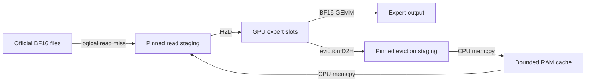

# BF16 Qwen3.6 / Clover: Windows performance comparison

Complete official BF16 weights ran through native Strata CUDA executables on
this machine. Qwen causal and Clover causal have similar measured throughput.
Clover self-speculative exact is slower in these tests because its extra expert
traffic, cache behavior and, on ordinary text, draft rejection offset batching.
These results describe this experimental implementation, not an all-GPU BF16
limit or a benchmark of HF block denoising.

## Machine, code and protocol

Windows 11 Pro 10.0.26200, Ryzen 7 9700X, two 32 GiB DIMMs (61.62 GiB OS-visible),
RTX 5070 Ti 16,303 MiB, queried compute capability 12.0, driver 610.88,
CUDA Toolkit 13.2.78 / VS2022. C: NTFS on Lexar ARES PRO 2 TB NVMe. Native Windows;
no WSL, Linux or SGLang serving stack. Original Strata path remained opt-out.

Both independent branches start at `46c152a1310f77cd2f0ce2c7cd213962df14fe83`:

- Qwen native code: `d18ee751ac05c1ae8109f79f55c87963998d99d3`.
  Executable SHA256 `12dd9ab381e1edc0929b898c2db8f06d3280a1cb493bd46d55dee282785d44c2`.
- Clover native code: `fa45fdfd548f9332aa57f40d43f05c12d078ead5`.
  Executable SHA256 `af9bce49e5e3b59715ba45458bc033c9aa3c290ec6b5a22b10e183b041b0ddf3`.
- Qwen checkpoint: `995ad96eacd98c81ed38be0c5b274b04031597b0`.
- Clover checkpoint: `4b0402b65e523d0183a14c431955438714cb16ff`.

The JSON evidence contains each run's actual source commit/dirty state and
binary hash. Later documentation/tool commits do not change these executables.
Qwen uses all 40 text layers and all routed/shared experts. Vision and MTP are
retained on disk but not executed in this causal text baseline. No quantization,
expert pruning, residency-biased routing or approximate acceptance was used.
Both runtimes share the bounded DirectFile/Gemm storage/execution design,
with each model's distinct rounding semantics. This comparison does not measure
the optimized original quantized q36 engine or CPU BF16 expert execution.

Greedy, thinking disabled, presence/frequency/repetition = 0/0/1, context 256,
prefill chunk 32, staging 16 MiB, two identical requests per process; audit and
trace off. Official templates produced identical input IDs for each prompt.
All weight downloads and correctness oracles finished before measurements.
First/warm means application expert caches; neither proves cold physical SSD.
TTFT excludes model opening/CUDA initialization; native first-token availability
is measured, while the wrapper prints completion after exit.

## Observed throughput

`Count from 1 to 10.`: 21 input IDs, 16 output IDs. Warm steady token/s:

| RAM expert cache / GPU expert cache | Qwen causal | Clover causal | Clover selfspec width 8 |
| --- | ---: | ---: | ---: |
| 0 / 6 GiB | 4.612 | 4.668 | 1.871 |
| 8 / 6 GiB | 5.086 | 4.968 | 1.994 |
| 8 / 8 GiB | 5.912 | 5.607 | 3.853 |

Every case/repeat returned the same 16 IDs for this prompt (`1, 2, 3, 4, 5, 6`;
the length limit ends before 10). [Both requests and phase data](bf16-comparison/count-20261029.json)
include actual times, transfers, per-layer expert unions and memory.

`Explain why the sky is blue in two sentences.`: 23 input IDs, 32 output IDs,
RAM/GPU expert caches both 8 GiB. Warm steady token/s:

| Qwen causal | Clover causal | Clover selfspec width 8 |
| ---: | ---: | ---: |
| 4.818 | 4.808 | 2.010 |

Clover causal and exact outputs matched in both repeats. Different model
checkpoints are not required to produce the same text. [Text-prompt evidence](bf16-comparison/text-20261029.json).
These are short observations, not statistical guarantees or quality rankings.

Additional sequential width controls on the same text prompt and 8/8 GiB:

| Clover runtime width | First request token/s | Warm request token/s |
| --- | ---: | ---: |
| 2 | 3.707 | 3.088 |
| 4 | 3.277 | 2.931 |
| 8 (text matrix above) | See raw evidence | 2.010 |

All width-2/4 outputs matched the causal 32 IDs in both requests.
[Width evidence](bf16-comparison/width-20261029.json) preserves both repeats,
commands, phases and hashes. These widths reduce H2D from width-8's 67.072 GiB
to 27.422 and 33.152 GiB respectively; extra preview/verify/replay still makes
them slower than the measured causal path. First-to-warm variability is visible;
no confidence interval or universal best width is inferred from two requests.

## Where the approximately 2 token/s goes

In the Count control with RAM 8 / GPU 6 GiB, a warm decode produces the next
15 tokens in 7.522 seconds. Instrumented, non-overlapping host sections:

| Host wall-clock section | Seconds | Share of decode |
| --- | ---: | ---: |
| Weight memcpy on CPU | 2.916 | 38.8% |
| File submit/completion wait | 1.708 | 22.7% |
| GPU eviction D2H enqueue/synchronization | 1.078 | 14.3% |
| RAM-hit H2D staging wait | 0.408 | 5.4% |
| File-read H2D staging wait | 0.171 | 2.3% |
| Remaining control/launch/compute/logging work | 1.241 | 16.5% |

Host weight copies total 56.256 GiB for those 15 tokens. Requested weight H2D
and D2H are each 32.719 GiB. Increasing RAM cuts logical file reads from
32.719 to 9.182 GiB, but the extra demotion/promotion copies offset much of the
benefit: 1.871 becomes 1.994 token/s. With RAM zero, file waiting is about 77%
of decode, so SSD access is a major bottleneck in that configuration. With
RAM 8 GiB it is about 23%; CPU copies and synchronization become more prominent.

The first implementation intentionally serializes these dependencies for
correctness. Every expert also synchronizes and copies small row/weight
metadata before launching work. The RAM tier is exclusive, so promotion drops
its host copy and later GPU eviction can require another D2H. These are
implementation costs, not required arithmetic in the model definition.

A separate Nsight Systems CUDA trace of the same Clover arithmetic/cache path
(RAM 8 / GPU 6, before timing-only instrumentation) recorded one warm decode:
0.143 seconds in 47,016 GPU kernels, 1.624 seconds in GPU copies, and 5.049
seconds between recorded GPU operations, over approximately 6.83 seconds.
[Phase intervals and method](bf16-comparison/clover-nsight-20261029.json).
This is a profiler sample, not the later unprofiled timing table. Kernel
arithmetic itself occupies about 2.1% of that sample. Many small launches and
host synchronization still matter; a low kernel-execution share does not make
their scheduling overhead disappear. Do not add CUDA API wait durations to GPU
copy durations: they overlap. No SM-occupancy percentage is inferred here.

## Cache capacity and generation flow

One expert is 6 MiB. GPU 6 GiB holds 1,024 experts, while each Count verify/replay
uses 1,229 or 1,234 unique experts over all 40 layers (about 7.2 GiB). Sequential
LRU rescanning evicts entries before reuse: replay had zero GPU hits. GPU 8 GiB
holds 1,365 experts; all 2,463 replay accesses hit. Replay total drops from
2.667 to 0.217 seconds, and steady throughput rises from 1.994 to 3.853 token/s.
No router or expert contribution changed. This cache-fit result is prompt-specific.

The implemented flow is full-model parallel preview, causal verify and an
**additional full causal commit replay**. It is SGLang-style exact acceptance,
not HF's iterative block denoising. Preview keeps the official dynamic coreset;
verify/replay do not. A draft width of 8 does not restrict a whole block to
8 experts. In the Count example, drafts matched 7/7 in both rounds; poor draft
acceptance did not cause that case's slowdown. Nevertheless selfspec evaluates
6,292 experts for 15 new output tokens, versus causal's 4,800. With GPU 8 GiB,
H2D is 15.422 versus 9.281 GiB. The extra traffic offsets fewer dense forwards.

Ordinary text also has poor exact acceptance: successive matched draft lengths
were 1,4,2,1,1,4,1,2,1,7. The final round is output-length truncated. Ten rounds
produce the next 31 tokens, with 30 full forwards versus 31 causal calls, but
26,595 expert evaluations versus 9,920. H2D reaches 67.072 GiB versus 19.277 GiB.
Unaccepted positions still cost preview/verification work. Replay here is only
0.941 seconds; most added time is preview (4.068 s) and verify (10.339 s).
Changing only the replay mechanism would not remove this draft-quality cost.

The trained Clover block size remains 32; runtime width changes must retain
that history-scaling semantics. Wider speculation is not automatically faster.
No result for HF block denoising or threshold acceptance is implied.

## Correctness, memory and limits

Qwen generated `Hello!` and EOS through the complete native text model.
All 80 KV/conv/SSM state files matched independent one-token causal replay by
SHA256, with different RAM/VRAM budgets. Synthetic expert/cache tests passed
24 cases in each branch after timing instrumentation. Qwen metadata validation
rejects eight corrupt layouts; production rejects incomplete and selected-layer
indices. All 26 official Qwen shards were SHA256-verified before execution.

Full cross-engine numerical validation is still unfinished. Qwen's streamed
HF comparison failed: logits max/mean absolute error 0.984375/0.0599591,
relative RMS 0.0320939, first differing expert set at layer 4; final-position
argmax matched. Selected L0 GDN passed 60 comparisons. L3 attention/KV/output
passed 42 tensor checks, but one router-weight integration RMS 0.0056448 exceeded
0.004. Given identical native logits, isolated routing matched Torch sets and
BF16 weights exactly. All failures are retained in
[Qwen validation evidence](bf16-comparison/qwen-validation-20261029.json).
Clover's earlier complete HF comparison also failed (logits RMS 0.1486412),
as its adapter notes explain. Native state equality does not prove HF parity.
These results therefore remain an experimental comparison, not complete
validated support or model-quality claims.

At RAM/GPU caches 8/8 GiB, native peak working sets were about 8.48 GiB,
peak private commit about 21.7 GiB, and sampled whole-device VRAM about 14.03 GiB.
Windows commit includes CUDA/WDDM backing. Cache budgets are not total process
memory. NVML samples include desktop/other processes and are not exact
per-process GPU peaks. Logical/aligned file completions are not physical SSD
traffic; physical SSD bytes and true cold I/O remain unmeasured.

## Reproduction and next priorities

Use [Qwen Windows build/download/index/run notes](QWEN36_BF16_WINDOWS.md).
Clover's equivalent notes are on the
[Clover branch](https://github.com/wenlive/Strata/blob/feat/clover-bf16-windows/docs/CLOVER_BF16_WINDOWS.md).
`tools/qwen35/compare_bf16.py --help` describes the sequential control driver;
its complete commands are in the linked build notes. The local task scripts
used the same settings and retained raw native logs.
`tools/qwen35/summarize_bf16_comparison.py --runs <root>` reproduces the tables
from their result/phase logs. Prompt, budgets, sampling and output limits are
stored in every case's config/request files.

Measured priorities are reducing host weight copies and synchronization,
avoiding rescan cache thrashing, and overlapping bounded reads/transfers with
computation. State commit could reuse causal verification intermediates instead
of rereading experts in a full replay; that optimization is not implemented here.
Grouping/fusing work can reduce launch overhead after these larger costs are
addressed. A faster SSD alone does not remove the measured host-copy or
speculation costs. No speedup factor is promised without another measurement.
